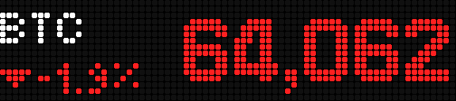
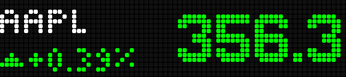
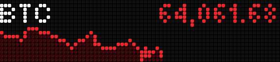
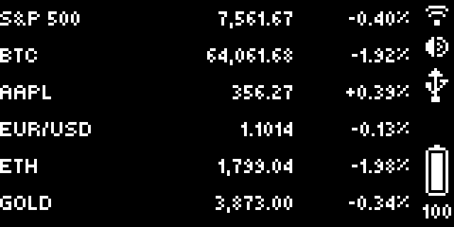
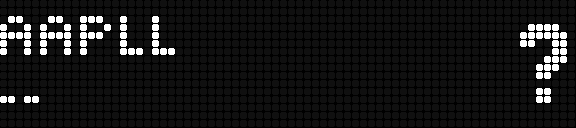
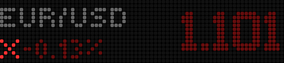
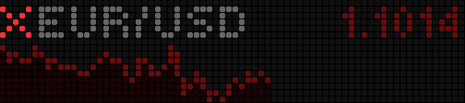
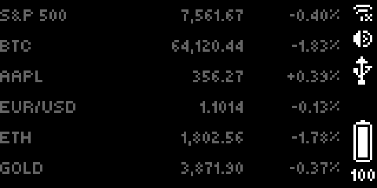

# Market Ticker

Stocks, indices, crypto and currencies in large digits, gains in green and losses in red.



Put up to six Yahoo Finance symbols in the settings and the front display shows them in turn: the price in large digits, the day's change beside it. Turn the wheel to hold one ticker, press OK to see its chart for the day; the back display keeps a table of all of them.

A JavaScript app for [BUSY Bar](https://busy.app).

## What the bar shows

The front display shows one ticker at a time and the next one every five seconds: the price in large digits on the right, and on the left, small, the ticker's label and under it the day's change after an arrow. The price, the change and the arrow are green on a rise and red on a fall.




Large prices are shortened to fit: from 1,000,000 in millions, such as `1.23M`; from 100,000 whole without separators; from 1,000 whole with separators, such as `64,062`; under 1,000 at most four digits, such as `356.3`; under 1 two or three significant digits. The full price is on the chart and on the back display.

The wheel picks a ticker and holds it on the display; half a minute after the last turn of the wheel or press of OK they take turns again. OK shows the held ticker's chart for the day instead: its label and full price small on top, and under them the line of its 15-minute closes from the start of the session, its low at the bottom and its high at the top, green on a rise and red on a fall. The chart stays, and the wheel switches between the tickers' charts, until OK takes it away.



The back display is a table of all the tickers: the label, the full price and the change with two decimals, in white.



A symbol Yahoo does not know, such as a typo in the settings, gets `?` for its price and `--` for its change.



The last good quotes are kept on the bar. At the start they are shown dimmed until the first answer, and a ticker with nothing kept shows `--`. When a request fails, the ticker's last quote stays, dimmed, and a red cross takes the arrow's place; on the chart the cross comes before the label.







The day's line of the chart is not kept: after a start without a connection the chart shows only the label and the price.

## Buttons

| Button | What it does |
| --- | --- |
| Wheel | Picks a ticker and holds it; on the chart, switches to the next ticker's chart. |
| OK | Shows the held ticker's chart for the day, and takes it away. |
| Back | Leaves the app. |

## Settings

| Setting | What it does |
| --- | --- |
| Tickers | Yahoo Finance symbols separated by commas, up to six, each optionally with `=Label`: `^GSPC=S&P 500, BTC-USD=BTC, EURUSD=X=EUR/USD`. Without a label the symbol up to its suffix is shown: `^GSPC` as GSPC, `BTC-USD` as BTC. A long label is cut to fit next to the price. Default: `^GSPC=S&P 500, BTC-USD=BTC`. |
| Minutes between updates | How often the quotes are requested, 1 to 60 minutes. Default: 5. |

The app reads its settings when it starts.

## Data

Yahoo Finance chart data, no key needed: one request per ticker for its price, its change since the previous close and its 15-minute closes of the day, every few minutes as the settings say.

## Build

Node 24 and npm:

```sh
npm ci
npm run build         # dist/io.github.vvzvlad.ticker.tgz
npm run app:install   # install it on a BUSY Bar connected over USB
npm run app:run       # start it
```

## License

[MIT](LICENSE)
